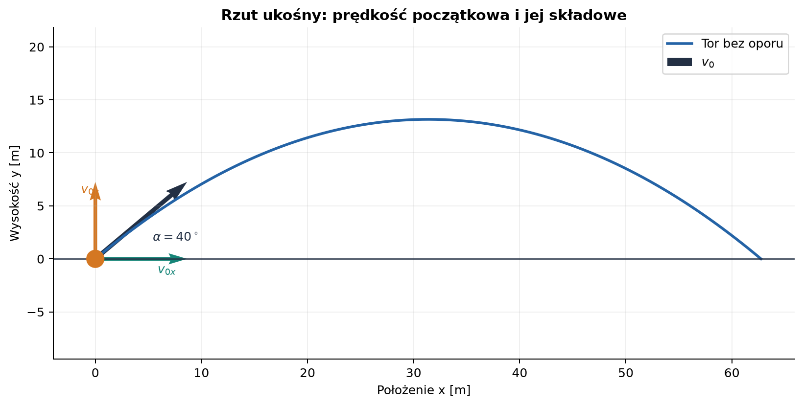
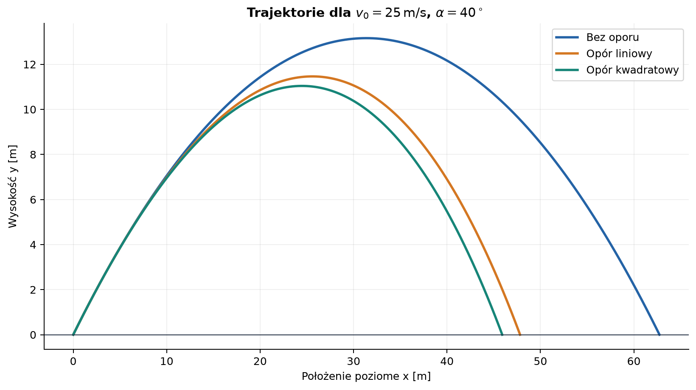
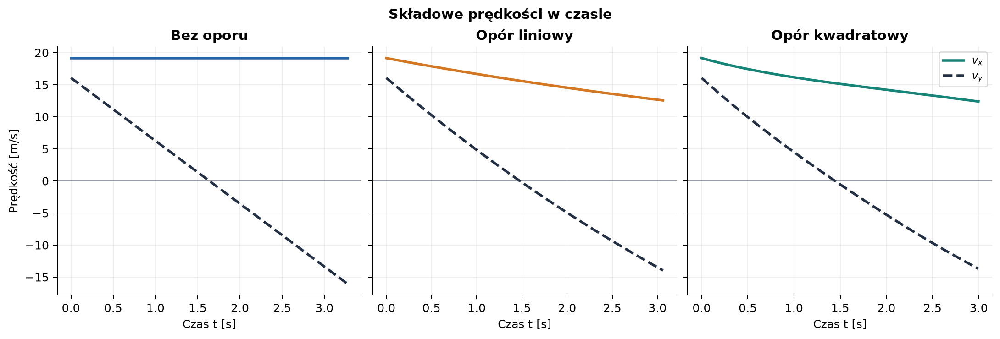
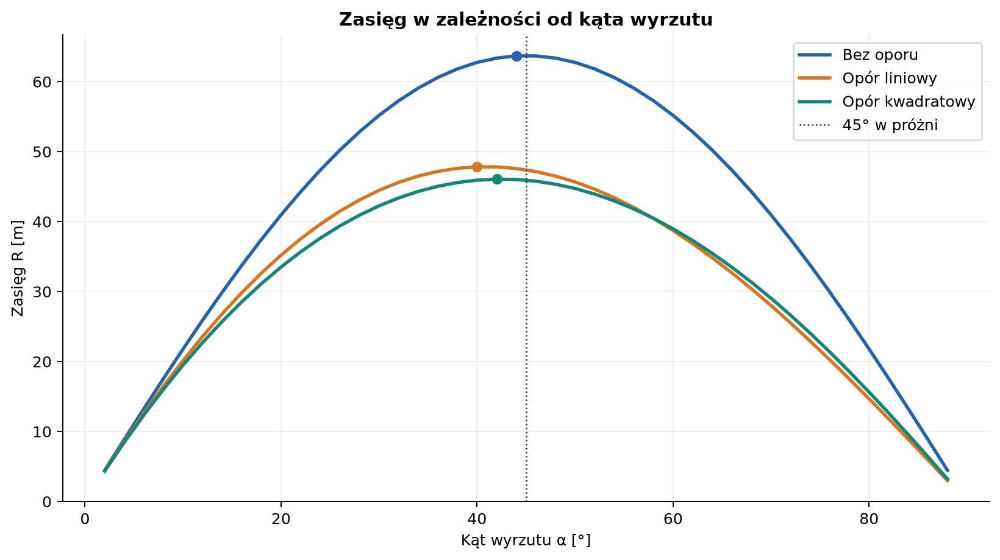
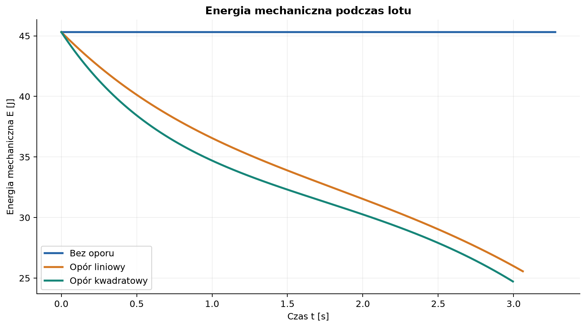

# Rzut ukośny — od ruchu idealnego do oporu powietrza

*Raport obliczeniowy i przykład dokumentacji naukowej w Markdown.*

**Temat:** ruch ciała wyrzuconego pod kątem do poziomu.  
**Metoda:** wyprowadzenie modelu analitycznego, symulacja numeryczna i porównanie wykresów.  
**Charakter danych:** przykład modelowy; nie są to pomiary laboratoryjne.

Rzut ukośny jest ruchem w dwóch wymiarach. W próżni składowa pozioma prędkości pozostaje stała, a pionowa zmienia się pod wpływem grawitacji. W powietrzu siła oporu zależy od prędkości: jej uwzględnienie sprzęga oba kierunki ruchu i na ogół wymaga rozwiązania numerycznego.

> Ten sam kąt i prędkość początkowa nie oznaczają tej samej trajektorii, gdy zmienimy model oporu. W szczególności opór zmniejsza zasięg i sprawia, że optymalny kąt rzutu zwykle nie wynosi 45°.

## Spis treści

1. [Cel, założenia i oznaczenia](#1-cel-założenia-i-oznaczenia)
2. [Rzut bez oporu powietrza](#2-rzut-bez-oporu-powietrza)
3. [Rzut z oporem powietrza](#3-rzut-z-oporem-powietrza)
4. [Przykład liczbowy](#4-przykład-liczbowy)
5. [Wykresy i interpretacja](#5-wykresy-i-interpretacja)
6. [Metoda numeryczna i kod](#6-metoda-numeryczna-i-kod)
7. [Ograniczenia modelu](#7-ograniczenia-modelu)
8. [Jak odtworzyć rysunki](#8-jak-odtworzyć-rysunki)
9. [Wnioski](#9-wnioski)
10. [Dalsza lektura](#10-dalsza-lektura)

---

## 1. Cel, założenia i oznaczenia

Celem jest opisanie położenia, prędkości, czasu lotu i zasięgu dla rzutu ukośnego bez oporu oraz porównanie dwóch modeli oporu: siły proporcjonalnej do prędkości i siły proporcjonalnej do kwadratu szybkości.

### 1.1. Założenia

- Ziemię traktujemy jako płaską, a przyspieszenie grawitacyjne jako stałe.
- Oś $x$ jest pozioma, a oś $y$ skierowana pionowo w górę.
- Początek układu znajduje się w punkcie wyrzutu: $x(0)=y(0)=0$.
- Kąt $\alpha$ mierzymy od dodatniego kierunku osi poziomej.
- W modelu oporu pomijamy wiatr, wypór, obrót ciała i zmianę jego orientacji.
- Lądowanie następuje na wysokości punktu wyrzutu.

W raporcie użyto demonstracyjnie $v_0=25\,\mathrm{m/s}$ oraz $\alpha=40^\circ$. **W zadaniu szkolnym zastąp te liczby dwiema pierwszymi i dwiema ostatnimi cyframi własnego indeksu** (odpowiednio w $\mathrm{m/s}$ i stopniach), zarówno w raporcie, jak i na początku dołączonego skryptu. Jeśli końcowe cyfry nie oznaczają kąta z zakresu $0^\circ$–$90^\circ$, sprawdź z nauczycielem oczekiwaną interpretację; nie zmieniaj po cichu wartości przypisanej indeksem.



*Rysunek 1. Kąt początkowy jest liczony od poziomu. Schemat przedstawia idealną parabolę i nie zachowuje skali.*

### 1.2. Symbole i jednostki

| Symbol | Znaczenie | Jednostka SI |
| :--- | :--- | :---: |
| $x,y$ | współrzędne położenia | $\mathrm{m}$ |
| $v_x,v_y$ | składowe prędkości | $\mathrm{m/s}$ |
| $v_0$ | wartość prędkości początkowej | $\mathrm{m/s}$ |
| $\alpha$ | kąt wyrzutu względem poziomu | $^\circ$ lub $\mathrm{rad}$ |
| $a_x,a_y$ | składowe przyspieszenia | $\mathrm{m/s^2}$ |
| $g$ | przyspieszenie grawitacyjne | $\mathrm{m/s^2}$ |
| $t_f$ | czas lotu do powrotu na wysokość wyrzutu | $\mathrm{s}$ |
| $H,R$ | maksymalna wysokość i zasięg | $\mathrm{m}$ |
| $m$ | masa ciała | $\mathrm{kg}$ |
| $b$ | współczynnik oporu liniowego | $\mathrm{kg/s}$ |
| $\rho$ | gęstość powietrza | $\mathrm{kg/m^3}$ |
| $C_d$ | bezwymiarowy współczynnik oporu | bez jednostki |
| $A$ | pole przekroju ciała prostopadłe do ruchu | $\mathrm{m^2}$ |

## 2. Rzut bez oporu powietrza

### 2.1. Równania ruchu

Prędkość początkowa rozkłada się na składowe:

$$
v_{0x}=v_0\cos\alpha,
\qquad
v_{0y}=v_0\sin\alpha.
$$

Jedyną siłą jest ciężar $\vec{F}_g=m\vec{g}$. Z drugiej zasady Newtona w kierunkach poziomym i pionowym otrzymujemy:

$$
m\ddot{x}=0,
\qquad
m\ddot{y}=-mg,
$$

czyli $\ddot{x}=0$ i $\ddot{y}=-g$. Całkując po czasie i stosując warunki początkowe $x(0)=y(0)=0$, dostajemy:

$$
x(t)=v_0\cos\alpha\,t,
\qquad
y(t)=v_0\sin\alpha\,t-\frac{1}{2}gt^2.
$$

Prędkości i przyspieszenia wynoszą:

$$
v_x(t)=v_0\cos\alpha,
\qquad
v_y(t)=v_0\sin\alpha-gt,
$$

$$
a_x=0,
\qquad a_y=-g.
$$

### 2.2. Kształt toru

Z pierwszego równania położenia $t=x/(v_0\cos\alpha)$. Podstawienie do równania $y(t)$ eliminuje czas:

$$
y(x)=x\tan\alpha-
\frac{gx^2}{2v_0^2\cos^2\alpha}.
$$

Jest to parabola otwarta w dół. Wysokość rośnie, gdy $v_y>0$, osiąga maksimum, gdy $v_y=0$, a następnie maleje.

### 2.3. Czas lotu, wysokość i zasięg

W najwyższym punkcie $v_y=0$, a więc $t_H=v_0\sin\alpha/g$. Po wstawieniu tej chwili do $y(t)$:

$$
H=\frac{v_0^2\sin^2\alpha}{2g}.
$$

Punkt lądowania spełnia $y(t_f)=0$. Oprócz rozwiązania $t=0$ otrzymujemy:

$$
t_f=\frac{2v_0\sin\alpha}{g}.
$$

Zasięg to poziome położenie w chwili lądowania:

$$
R=x(t_f)=v_0\cos\alpha\,t_f
=\frac{v_0^2\sin(2\alpha)}{g}.
$$

Dla ustalonego $v_0$ i jednakowych wysokości początku oraz końca zasięg bez oporu jest maksymalny przy $\alpha=45^\circ$, ponieważ maksymalizuje to $\sin(2\alpha)$. Wzór ten nie obowiązuje wprost przy różnych wysokościach lądowania ani przy oporze.

**Kontrola jednostek:** $v_0^2/g$ ma jednostkę $\mathrm{m^2/s^2}/\mathrm{m/s^2}=\mathrm{m}$, zgodną z wymiarem zasięgu i wysokości.

## 3. Rzut z oporem powietrza

Opór działa przeciwnie do wektora prędkości. W odróżnieniu od ciężaru nie jest skierowany stale pionowo w dół. Niech $v=\sqrt{v_x^2+v_y^2}$ oznacza szybkość.

### 3.1. Opór liniowy

W modelu liniowym:

$$
\vec{F}_d=-b\vec{v},
\qquad b>0.
$$

Po podzieleniu drugiej zasady Newtona przez masę:

$$
\dot{v}_x=-\frac{b}{m}v_x,
\qquad
\dot{v}_y=-g-\frac{b}{m}v_y.
$$

Oznaczając $\lambda=b/m$, rozwiązania dla składowych prędkości wynoszą:

$$
v_x(t)=v_{0x}e^{-\lambda t},
\qquad
v_y(t)=\left(v_{0y}+\frac{g}{\lambda}\right)e^{-\lambda t}-\frac{g}{\lambda}.
$$

Całkowanie przy $x(0)=y(0)=0$ daje:

$$
x(t)=\frac{v_{0x}}{\lambda}\left(1-e^{-\lambda t}\right),
$$

$$
y(t)=\frac{v_{0y}+g/\lambda}{\lambda}
\left(1-e^{-\lambda t}\right)-\frac{g}{\lambda}t.
$$

Opór poziomy zmniejsza $v_x$, a pionowa prędkość graniczna przy długim spadaniu wynosi $-g/\lambda=-mg/b$. Model liniowy jest użytecznym przybliżeniem przy małych szybkościach lub w odpowiednim zakresie przepływu.

### 3.2. Opór kwadratowy

Dla wielu ciał poruszających się w powietrzu z typowymi szybkościami stosuje się model kwadratowy:

$$
\vec{F}_d=-\frac{1}{2}\rho C_d A\,v\vec{v}.
$$

Po oznaczeniu $c=\tfrac12\rho C_dA$ równania składowych przyjmują postać:

$$
\dot{x}=v_x,
\qquad \dot{y}=v_y,
$$

$$
\dot{v}_x=-\frac{c}{m}v v_x,
\qquad
\dot{v}_y=-g-\frac{c}{m}v v_y.
$$

Jednostką $c$ jest $\mathrm{kg/m}$. Ponieważ współczynnik siły zależy od bieżącej szybkości, równania są sprzężone i na ogół nie mają prostego rozwiązania analitycznego. W raporcie całkujemy je numerycznie. W pionowym spadaniu graniczną szybkość można oszacować z równowagi ciężaru i oporu:

$$
mg=\frac12\rho C_d A v_{\mathrm{gr}}^2,
\qquad
v_{\mathrm{gr}}=\sqrt{\frac{2mg}{\rho C_d A}}.
$$

### 3.3. Zmiana energii

Energia mechaniczna, liczona względem poziomu wyrzutu, wynosi:

$$
E=\frac12m(v_x^2+v_y^2)+mgy.
$$

Moc siły oporu to $\vec{F}_d\cdot\vec{v}$. Stąd:

$$
\frac{dE}{dt}=\vec{F}_d\cdot\vec{v}
=\begin{cases}
-b v^2 & \text{dla oporu liniowego},\\
-\frac12\rho C_dA v^3 & \text{dla oporu kwadratowego}.
\end{cases}
$$

Obie wartości są niedodatnie: energia mechaniczna jest rozpraszana, głównie jako energia wewnętrzna powietrza i ciała.

## 4. Przykład liczbowy

Poniższe parametry są wyłącznie przykładowe i służą do porównania modeli:

| Parametr | Wartość | Uzasadnienie |
| :--- | ---: | :--- |
| $v_0$ | $25{,}0\,\mathrm{m/s}$ | wartość demonstracyjna |
| $\alpha$ | $40^\circ$ | wartość demonstracyjna |
| $g$ | $9{,}81\,\mathrm{m/s^2}$ | standardowe przybliżenie przy powierzchni Ziemi |
| $m$ | $0{,}145\,\mathrm{kg}$ | przykładowa masa piłki |
| $\rho$ | $1{,}225\,\mathrm{kg/m^3}$ | przybliżenie dla suchego powietrza w warunkach standardowych |
| $C_d$ | $0{,}47$ | przybliżenie dla kuli; zależy od przepływu i powierzchni |
| $A$ | $0{,}0042\,\mathrm{m^2}$ | przykładowe pole przekroju |
| $b$ | $0{,}020\,\mathrm{kg/s}$ | parametr demonstracyjny modelu liniowego |

Początkowe składowe prędkości wynoszą:

$$
v_{0x}=25\cos(40^\circ)\approx19{,}15\,\mathrm{m/s},
\qquad
v_{0y}=25\sin(40^\circ)\approx16{,}07\,\mathrm{m/s}.
$$

Bez oporu przewidywany czas lotu, maksymalna wysokość i zasięg to w przybliżeniu:

| Wielkość | Wynik bez oporu | Jednostka |
| :--- | ---: | :---: |
| Czas lotu $t_f$ | $3{,}28$ | $\mathrm{s}$ |
| Czas do wierzchołka $t_H$ | $1{,}64$ | $\mathrm{s}$ |
| Maksymalna wysokość $H$ | $13{,}17$ | $\mathrm{m}$ |
| Zasięg $R$ | $62{,}8$ | $\mathrm{m}$ |

Wartości dla obu modeli oporu skrypt wyznacza numerycznie i umieszcza w konsoli. Nie należy interpretować przykładowego $C_d$ jako stałej dla każdej piłki: rzeczywista wartość zależy m.in. od liczby Reynoldsa, szwów i rotacji.

## 5. Wykresy i interpretacja



*Rysunek 2. Opór skraca zasięg i obniża tor. Krzywa kwadratowa odpowiada przykładowej piłce; wynik zależy od przyjętych parametrów.*



*Rysunek 3. Bez oporu $v_x$ jest stałe. Z oporem obie składowe ulegają zmianie; w najwyższym punkcie toru $v_y=0$, ale $v_x$ na ogół nie jest zerowe.*



*Rysunek 4. W próżni maksimum przypada dokładnie na $45^\circ$. W tym przykładzie opór przesuwa maksimum ku mniejszym kątom, ponieważ dłuższy lot oznacza więcej czasu na utratę prędkości poziomej.*



*Rysunek 5. Spadek energii mechanicznej odpowiada pracy wykonanej przez siłę oporu; nie oznacza zniknięcia energii całkowitej układu ciało–powietrze.*

Na wykresach widać trzy różnice wynikające bezpośrednio z równań: opór poziomy zmniejsza zasięg, składowa pozioma prędkości przestaje być stała, a energia mechaniczna maleje. Kształt toru z oporem nie jest dokładnie parabolą. Przy porównaniu zasięgu dla różnych kątów wszystkie obliczenia rozpoczynają się z tą samą szybkością i kończą przy powrocie na wysokość wyrzutu.

## 6. Metoda numeryczna i kod

Dla oporu kwadratowego definiujemy stan układu jako $\mathbf{z}=(x,y,v_x,v_y)$. Równania różniczkowe mają postać:

$$
\dot{\mathbf{z}}=
\left(v_x,\;v_y,\;-\frac{c}{m}v v_x,\;-g-\frac{c}{m}v v_y\right),
\qquad v=\sqrt{v_x^2+v_y^2}.
$$

Całkowanie kończymy zdarzeniem $y=0$ z ruchem w dół. Ten warunek wybiera moment lądowania, a nie początkowe przejście przez poziom wyrzutu. Skrypt [`generuj_wykresy.py`](generuj_wykresy.py) zawiera kompletną implementację, zapis pięciu rysunków oraz kontrole warunków początkowych, zdarzenia lądowania i zaniku energii w modelach oporu.

Najważniejsza część solvera wygląda tak:

```python
def rhs(_time, state):
    x, y, vx, vy = state
    speed = np.hypot(vx, vy)
    coefficient = 0.5 * RHO * CD * AREA * speed / MASS
    return vx, vy, -coefficient * vx, -G - coefficient * vy

def landing(_time, state):
    return state[1]

landing.terminal = True
landing.direction = -1
```

Funkcja `solve_ivp` z biblioteki SciPy dostarcza adaptacyjny integrator równań różniczkowych. Dla modelu liniowego w tej samej funkcji prawej strony przyspieszenia oporu wynoszą `-B_LINEAR * vx / MASS` oraz `-B_LINEAR * vy / MASS`.

## 7. Ograniczenia modelu

- Przyjęto stałą gęstość powietrza i stałe $C_d$; to przybliżenie, nie pełny model aerodynamiki.
- Pominięto wiatr i siłę Magnusa. Rotująca piłka może odchylić się od pokazanych torów.
- Nie uwzględniono zmian wysokości nad Ziemią ani krzywizny planety, co jest uzasadnione dla krótkich lotów.
- Model liniowy i kwadratowy są przybliżeniami dla różnych zakresów przepływu; nie należy utożsamiać ich parametrów.
- Numeryczny wynik zależy od parametrów i tolerancji solvera. W skrypcie dobrano tolerancje tak, by błędy numeryczne były małe względem dokładności danych wejściowych.

## 8. Jak odtworzyć rysunki

Wymagany jest Python 3 oraz pakiety NumPy, Matplotlib i SciPy. Z terminala w folderze `pages/solutions/04_sol_vscode` uruchom:

```bash
python -m pip install numpy matplotlib scipy
python generuj_wykresy.py
```

Skrypt zapisze pliki PNG w `files/rzut_ukosny/`. Jeśli realizujesz zadanie z numerem indeksu, zmień `V0` i `ALPHA_DEG` w pierwszej sekcji skryptu przed uruchomieniem, a następnie zaktualizuj wartości opisowe w tym raporcie. Wykres zasięgu i podpisy zostaną wygenerowane ponownie dla nowych parametrów.

## 9. Wnioski

1. Bez oporu rzut ukośny jest superpozycją ruchu jednostajnego w poziomie i ruchu jednostajnie przyspieszonego w pionie; tor jest parabolą.
2. Dla startu i lądowania na tej samej wysokości czas lotu, wysokość oraz zasięg wynikają bezpośrednio ze składowych prędkości początkowej.
3. Siła oporu działa przeciwnie do prędkości. W modelu liniowym przyspieszenie oporu jest proporcjonalne do prędkości, a w kwadratowym do iloczynu szybkości i wektora prędkości.
4. Opór zmienia tor, czas lotu, zasięg i energię mechaniczną; w ogólności nie istnieją proste wzory analogiczne do wszystkich wzorów dla próżni.
5. Kąt maksymalizujący zasięg zależy od oporu i parametrów ciała. Wartość $45^\circ$ jest wynikiem modelu bez oporu przy równych wysokościach początku i końca.

## 10. Dalsza lektura

- [OpenStax, University Physics Volume 1: Projectile Motion](https://openstax.org/books/university-physics-volume-1/pages/4-3-projectile-motion)
- [NASA Glenn Research Center: The Drag Equation](https://www1.grc.nasa.gov/beginners-guide-to-aeronautics/drag-equation/)
- [SciPy: `solve_ivp`](https://docs.scipy.org/doc/scipy/reference/generated/scipy.integrate.solve_ivp.html)