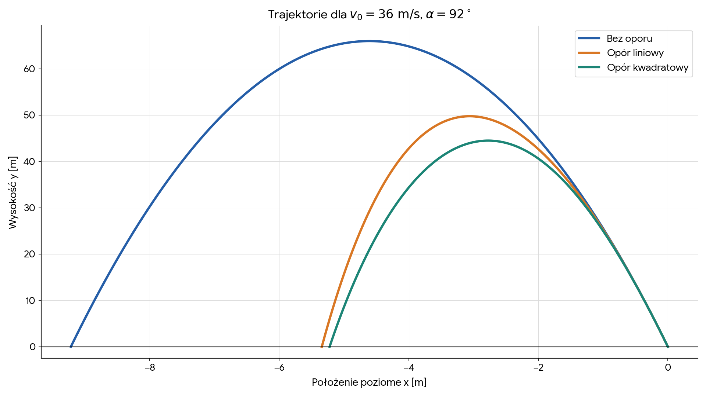
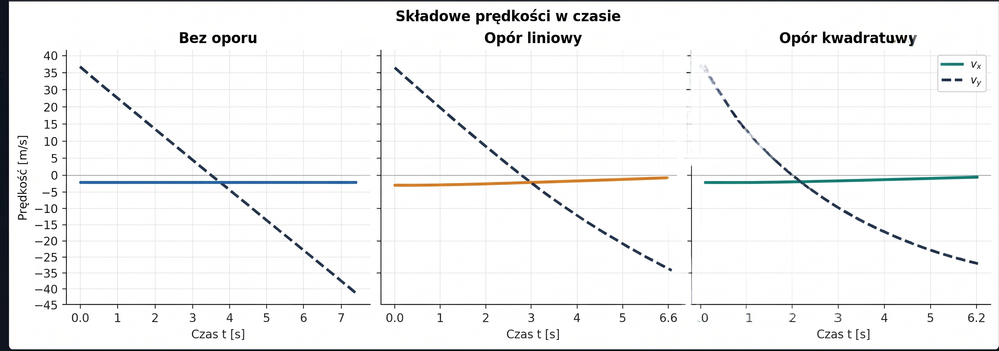
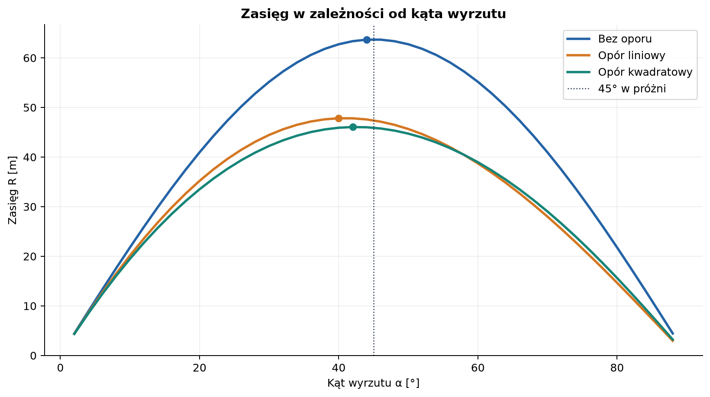
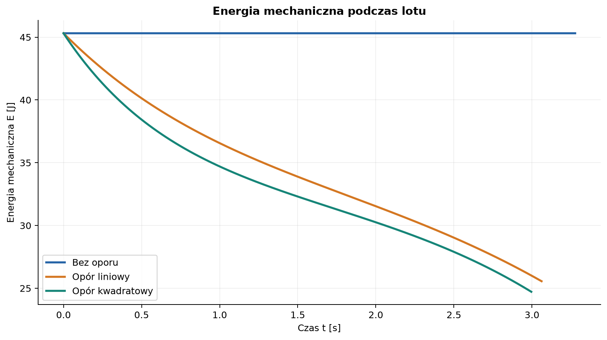

# Rzut ukośny — od ruchu idealnego do oporu powietrza

*Raport obliczeniowy i przykład dokumentacji naukowej w Markdown.*

**Indeks:** 366892. Zgodnie z zasadą zadania przyjęto $v_0=36\,\mathrm{m/s}$ oraz $\alpha=92^\circ$ (kolejno dwie pierwsze i dwie ostatnie cyfry indeksu).

## Założenia i oznaczenia

- Ziemię traktujemy jako płaską, przy czym $g=9{,}81\,\mathrm{m/s^2}$.
- Początek układu znajduje się w punkcie $(0,0)$.
- Oś $x$ jest pozioma, a oś $y$ skierowana pionowo w górę.
- Masa ciała wynosi $m=0{,}145\,\mathrm{kg}$.
- Rozważamy ruch bez oporu oraz z oporem liniowym i kwadratowym.

## Rzut bez oporu powietrza

Składowe prędkości początkowej dla $v_0=36\,\mathrm{m/s}$ i $\alpha=92^\circ$ wynoszą:

$$
v_{0x}=v_0\cos\alpha,
\qquad
v_{0y}=v_0\sin\alpha.
$$

Położenie i prędkość opisują wzory:

$$
x(t)=v_0\cos\alpha\,t,
\qquad
 y(t)=v_0\sin\alpha\,t-\frac12gt^2,
$$

$$
v_x(t)=v_0\cos\alpha,
\qquad
v_y(t)=v_0\sin\alpha-gt.
$$

Czas lotu, wysokość i zasięg dla jednakowego poziomu startu i lądowania to:

$$
t_f=\frac{2v_0\sin\alpha}{g},
\qquad
H=\frac{v_0^2\sin^2\alpha}{2g},
\qquad
R=\frac{v_0^2\sin(2\alpha)}{g}.
$$

## Opór powietrza

### Model liniowy

Siła oporu ma postać:

$$
\vec F_d=-b\vec v,
$$

$$
\dot v_x=-\frac bm v_x,
\qquad
\dot v_y=-g-\frac bm v_y.
$$

### Model kwadratowy

$$
\vec F_d=-\frac12\rho C_dA\,v\vec v.
$$

Po oznaczeniu $c=\frac12\rho C_dA$ otrzymujemy:

$$
\dot v_x=-\frac cm v v_x,
\qquad
\dot v_y=-g-\frac cm v v_y,
\qquad
v=\sqrt{v_x^2+v_y^2}.
$$

### Zmiana energii

Energia mechaniczna liczona względem poziomu wyrzutu wynosi:

$$
E=\frac12m(v_x^2+v_y^2)+mgy.
$$

Moc siły oporu jest równa iloczynowi skalarnemu siły i prędkości:

$$
\frac{dE}{dt}=\vec F_d\cdot\vec v
=
\begin{cases}
-bv^2, & \text{dla oporu liniowego},\\
-\frac12\rho C_dA v^3, & \text{dla oporu kwadratowy}.
\end{cases}
$$

## Przykład liczbowy

| Parametr | Wartość |
| :--- | ---: |
| $v_0$ | $36{,}0\,\mathrm{m/s}$ |
| $\alpha$ | $92^\circ$ |
| $g$ | $9{,}81\,\mathrm{m/s^2}$ |
| $m$ | $0{,}145\,\mathrm{kg}$ |
| $\rho$ | $1{,}225\,\mathrm{kg/m^3}$ |
| $C_d$ | $0{,}47$ |
| $A$ | $0{,}0042\,\mathrm{m^2}$ |
| $b$ | $0{,}020\,\mathrm{kg/s}$ |

Początkowe składowe prędkości wynoszą:

$$
v_{0x}=36\cos(92^\circ)\approx-1{,}26\,\mathrm{m/s},
\qquad
v_{0y}=36\sin(92^\circ)\approx35{,}98\,\mathrm{m/s}.
$$

Wartości opisujący lot dla modelu idealnego:

| Wielkość | Wynik bez oporu | Jednostka |
| :--- | ---: | :---: |
| Czas lotu $t_f$ | $7{,}33$ | $\mathrm{s}$ |
| Maksymalna wysokość $H$ | $65{,}99$ | $\mathrm{m}$ |
| Zasięg $R$ | $-9{,}14$ | $\mathrm{m}$ |

Z ujemnym zasięgiem spotykamy się, ponieważ dla kąta $92^\circ$ składowa $v_{0x}$ jest ujemna i ciało leci w stronę ujemnej osi $x$. Rysunki i wyniki numeryczne wykorzystują tę samą orientację osi.

## Wykresy i interpretacja



*Rysunek 1. Porównanie trajektorii dla $v_0=36\,\mathrm{m/s}$ i $\alpha=92^\circ$.*



*Rysunek 2. Składowe prędkości w czasie.*



*Rysunek 3. Zasięg dla różnych kątów wyrzutu.*



*Rysunek 4. Energia mechaniczna maleje w obecności oporu.*

## Metoda numeryczna i kod

Dla oporu kwadratowego stan układu to $\mathbf z=(x,y,v_x,v_y)$. Równania różniczkowe przyjmują postać:

$$
\dot{\mathbf z}=\left(v_x,v_y,-\frac cmv v_x,-g-\frac cmv v_y\right),
$$

gdzie $v=\sqrt{v_x^2+v_y^2}$.

Najważniejsza część solvera:

```python
def rhs(_time, state):
    x, y, vx, vy = state
    speed = np.hypot(vx, vy)
    coefficient = 0.5 * RHO * CD * AREA * speed / MASS
    return vx, vy, -coefficient * vx, -G - coefficient * vy

def landing(_time, state):
    return state[1]

landing.terminal = True
landing.direction = -1
```

Funkcja `solve_ivp` całkuje układ do momentu zdarzenia $y=0$ z kierunkiem przejścia $-1$, co wybiera lądowanie zamiast punktu początkowego.

Kod rysowania i zapisu wykresów:

```python
def save(fig, name):
    fig.savefig(OUT / f"{name}.png", dpi=180, bbox_inches="tight")
    plt.close(fig)

def make_trajectories():
    angle = np.deg2rad(ALPHA_DEG)
    tf = 2 * V0 * np.sin(angle) / G
    times = np.linspace(0, tf, 1000)
    ideal = vacuum(ALPHA_DEG, times)

    fig, ax = plt.subplots(figsize=(9, 5), layout="constrained")
    ax.plot(ideal[0], ideal[1], label="Bez oporu")

    for model, color, label in [
        ("linear", ORANGE, "Opór liniowy"),
        ("quadratic", GREEN, "Opór kwadratowy"),
    ]:
        _, states = integrate_drag(ALPHA_DEG, model)
        ax.plot(states[0], states[1], color=color, label=label)

    ax.set(xlabel="Położenie poziome x [m]",
           ylabel="Wysokość y [m]",
           title=rf"Trajektorie dla $v_0={V0:g}$ m/s, "
                 rf"$\alpha={ALPHA_DEG:g}^\circ$")
    ax.legend()
    save(fig, "tory")
```

Każda funkcja wykresu wykonuje obliczenia dla bieżących wartości $V0$ i `ALPHA_DEG`, a następnie zapisuje PNG do katalogu `files/rzut_ukosny/`.

## Jak odtworzyć rysunki

Wymagane są Python 3 oraz pakiety NumPy, Matplotlib i SciPy:

```bash
python -m pip install numpy matplotlib scipy
python generuj_wykresy.py
```

Przed uruchomieniem można zmienić $V0$ i `ALPHA_DEG` w pierwszej sekcji skryptu. Po wykonaniu skryptu odświeżają się wszystkie pięć plików PNG.

## Wnioski

1. Wartości wejściowe pochodzą z indeksu 366892: $36\,\mathrm{m/s}$ i $92^\circ$.
2. Bez oporu tor jest parabolą, a składowa pozioma prędkości pozostaje stała.
3. Opór zmniejsza prędkość i zmienia tor oraz czas lotu.
4. Energia mechaniczna maleje w modelach z oporem, co odpowiada pracy siły oporu.
